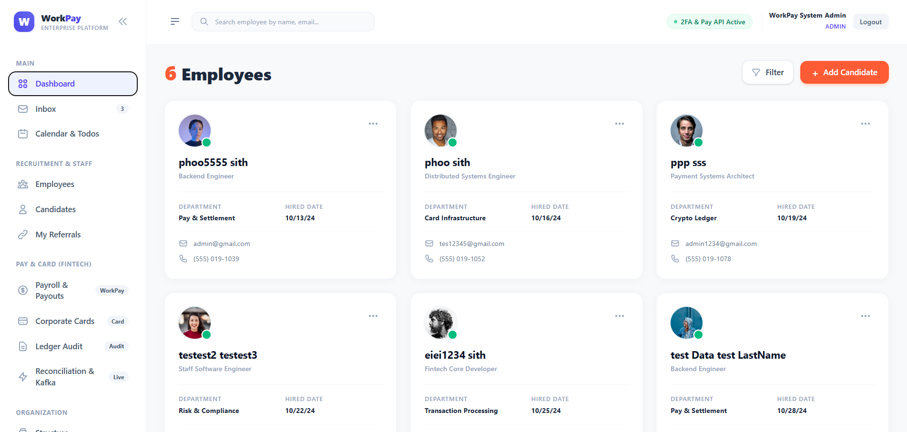
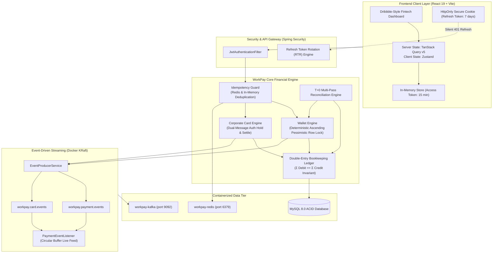

# WorkPay Enterprise Fintech & Corporate Card Platform

[](https://spring.io/projects/spring-boot)
[](https://react.dev/)
[](https://tanstack.com/query)
[-231f20.svg)](https://kafka.apache.org/)
[](https://redis.io/)
[](https://www.docker.com/)
[](https://opensource.org/licenses/MIT)

**WorkPay** is an enterprise-grade fintech platform engineered for high-concurrency workforce payment processing, virtual corporate card issuing, mathematical double-entry bookkeeping, and real-time Kafka event streaming. 

Designed following global core-banking and payment gateway standards (Stripe, Adyen, Revolut, Rippling), WorkPay guarantees **zero-double spending**, **deadlock-free pessimistic locking**, **T+0 automated financial reconciliation**, and **bank-grade in-memory session security**.

<p align="center">
  
</p>

---

## 🏛️ System Architecture



---

## 🚀 Key Engineering Highlights

### 1. High-Concurrency Concurrency & Idempotency
- **Idempotency-Key Guard**: Uses Redis key-value storage with atomic TTL locks to reject duplicate payment requests, eliminating accidental double-charges.
- **Deadlock-Free Pessimistic Row Locking**: All wallet transfers lock database rows with `PESSIMISTIC_WRITE` sorted in **ascending account ID order**, mathematically preventing circular wait deadlocks under high concurrent volume.

### 2. Mathematical Double-Entry Bookkeeping Ledger
- Adheres to standard financial accounting rules: every transfer generates paired Debit and Credit journal lines.
- Enforces the strict mathematical invariant:
  $$\sum \text{Debits} - \sum \text{Credits} = 0.0000$$
- Any transaction deviating by even `$0.0001` is immediately aborted via transactional rollback.

### 3. Virtual Corporate Cards & POS Dual-Message Flow
- Issues 16-digit virtual cards with CVV hashing and configurable daily/monthly limits.
- Supports POS dual-message processing:
  - **Authorize**: Validates limits and places funds on temporary `HOLD`.
  - **Settle**: Moves settled funds out of the wallet and updates spend metrics.
  - **Freeze / Unfreeze**: Real-time card locking.

### 4. Apache Kafka KRaft Event Streaming
- Runs **Apache Kafka 3.7.0** in modern KRaft mode (no ZooKeeper required) on Docker port `9092`.
- Asynchronously publishes payment and card events across partitioned topics (`workpay.payment.events`, `workpay.card.events`).
- Frontend features a real-time event streaming visualizer with 3-second live polling and partition message payload inspection.

### 5. Bank-Grade Token Management (No LocalStorage)
- **Zero LocalStorage Storage**: Access tokens are kept exclusively in **JavaScript in-memory closure**, neutralizing XSS token theft.
- **HttpOnly Cookie Refresh Tokens**: Long-lived refresh tokens are stored in `HttpOnly`, `SameSite=Lax`, `Secure` cookies inaccessible to JavaScript.
- **Refresh Token Rotation (RTR)**: Each token refresh revokes the prior token in the database and issues a new pair.
- **Axios Silent Refresh**: 401 Unauthorized responses trigger automatic background token renewal without interrupting the user.

### 6. Modern State Management
- **TanStack Query v5 (React Query)** handles all server state, cache deduplication, optimistic updates, and query invalidation.
- **Zustand** manages client authentication state and user session profile.

---

## 🛠️ Tech Stack

| Tier | Technologies |
|---|---|
| **Backend** | Java 17, Spring Boot 4.1.1, Spring Security, Spring Data JPA / Hibernate, Spring Kafka |
| **Frontend** | React 19, Vite, TanStack Query v5, Zustand, Tailwind CSS, Axios |
| **Database** | MySQL 8.0 (ACID Relational Storage) |
| **Messaging & Cache** | Apache Kafka 3.7.0 (KRaft), Redis 7 (Alpine) |
| **Infrastructure** | Docker Desktop, Docker Compose, WSL2 |
| **Observability** | Spring Boot Actuator, Micrometer Prometheus, Live Telemetry Dashboard |

---

## ⚡ Quick Start Guide

### Prerequisites
- Java 17+ installed
- Node.js 18+ & npm
- Docker Desktop running (with WSL2 enabled)
- MySQL 8.0 running on `localhost:3306`

### 1. Launch Containerized Infrastructure
Start Kafka and Redis with Docker Compose:
```bash
docker compose up -d
```
Verify containers are running:
```bash
docker ps
# Expected: workpay-kafka (port 9092) and workpay-redis (port 6379)
```

### 2. Configure & Start Backend
```bash
cd ems-backend

# Copy template configuration
cp src/main/resources/application.properties.example src/main/resources/application.properties

# Run tests
./mvnw clean test

# Start the Spring Boot API
./mvnw spring-boot:run
```
*Backend runs on `http://localhost:8080`*

### 3. Start Frontend Client
```bash
cd ../ems-frontend
npm install
npm run dev
```
*Frontend runs on `http://localhost:5173`*

---

## 🔑 Default Seed Accounts

The system automatically seeds an administrator, compensation wallets, and corporate cards on initial startup:

| Role / Wallet | Account / Email | Password | Initial Balance |
|---|---|---|---|
| **System Admin** | `admin@workpay.io` | `admin123` | N/A |
| **Corporate Treasury** | `WAL-MAIN-TREASURY` | N/A | $1,000,000.00 USDT |
| **Operations Payroll** | `WAL-OPS-PAYROLL` | N/A | $250,000.00 USDT |
| **Alice Smith (Employee)** | `alice.smith@workpay.io` | N/A | $6,500.00 USDT |
| **Bob Jones (Employee)** | `bob.jones@workpay.io` | N/A | $8,200.00 USDT |

---

## 📡 API Reference Overview

| Module | Method | Endpoint | Description |
|---|---|---|---|
| **Auth** | `POST` | `/api/auth/login` | Email/password login & generates OTP |
| **Auth** | `POST` | `/api/auth/verify-otp` | Validates OTP & sets HttpOnly cookie |
| **Auth** | `POST` | `/api/auth/refresh-token` | Rotates refresh token & issues access token |
| **Wallets** | `GET` | `/api/wallets` | Lists all corporate and employee wallets |
| **Wallets** | `POST` | `/api/wallets/transfer` | Idempotent transfer with row locking |
| **Cards** | `GET` | `/api/cards` | Lists virtual corporate cards |
| **Cards** | `POST` | `/api/cards/{id}/authorize` | POS swipe authorization hold |
| **Cards** | `POST` | `/api/cards/transactions/{id}/settle` | Settles hold and debits wallet |
| **Ledger** | `GET` | `/api/ledger/journals` | Inspects double-entry journal entries |
| **Ledger** | `GET` | `/api/ledger/audit` | Computes full mathematical balance |
| **Recon** | `POST` | `/api/reconciliation/run` | Triggers multi-pass batch reconciliation |
| **Recon** | `GET` | `/api/reconciliation/events` | Fetches live Kafka streaming events buffer |
| **Observability** | `GET` | `/api/reconciliation/metrics` | System telemetry & container health |
| **Actuator** | `GET` | `/actuator/prometheus` | Prometheus metric scrape target |

---

## 🧪 Testing & Verification

WorkPay includes unit, concurrency, and integration tests covering card authorization, double-entry mathematical invariants, and wallet transfers:

```bash
cd ems-backend
./mvnw test
```

```text
[INFO] Results:
[INFO] Tests run: 9, Failures: 0, Errors: 0, Skipped: 0
[INFO] BUILD SUCCESS
```

---

## 📄 License
This project is open-source under the [MIT License](LICENSE).
